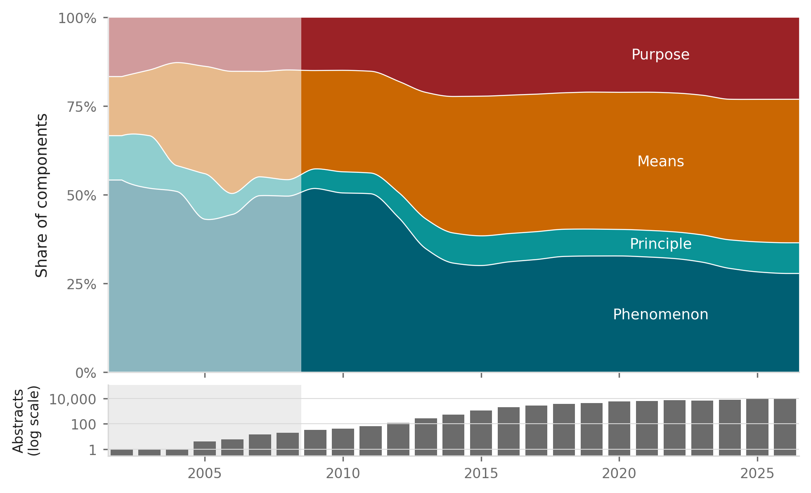

# Knowledge Deconstruction Engine (KDE)

### An LLM pipeline that breaks scientific abstracts into typed knowledge components, so that what a technology is made of can be observed at scale.

KDE reads paper abstracts with a language model and lists their knowledge components, following a fixed codebook based on Arthur's account of technology (*The Nature of Technology*, 2009):

- **phenomenon:** a natural or emergent regularity
- **principle:** the idea of using a phenomenon for a purpose
- **means:** something concrete that does work (a molecule, device, method, protocol)
- **purpose:** a need that a technology serves

For each component, KDE returns a type, a short label, the exact words from the abstract that support it, and a confidence rating (high, medium or low). Every evidence span is checked against the abstract, so nothing paraphrased or invented is kept.

This repository holds the tool, the coded CRISPR literature (71,514 abstracts, 879,376 components), and an evaluation against a human coder.



## Quick start

Requires Python 3.9 or later and your own [DeepSeek API key](https://platform.deepseek.com) (a free-tier route is planned). The example codes five CC BY abstracts in `tool/example/` and costs about USD 0.002.

```bash
git clone <repo-url> kde
cd kde/tool
pip install -r requirements.txt
cp .env.example .env          # then put your key after DEEPSEEK_API_KEY=
python -m src.run --ids example/ids.txt --name example
```

Output goes to `tool/runs/<timestamp>_example/`:

- `outputs.jsonl`: one line per abstract, `{"work_id", "components": [{"type", "label", "evidence", "confidence"}], "flags"}`
- `run_log.json`: model and settings, prompt and codebook hashes, counts per type and confidence, validation failures, tokens, cost
- `details.jsonl`: raw responses and every validation step

## Run KDE on your own abstracts

1. **Prepare a file** (`.csv`, `.jsonl` or `.parquet`) with columns `id`, `title`, `abstract`, `year`. Extra columns are ignored, and the title is never sent to the model.
2. **Point the config at it:** set `corpus.path` in `tool/config.yaml`, or pass `--corpus <file>`. If your column names differ, map them under `corpus.columns`.
3. **Run:**

   ```bash
   cd tool
   python -m src.run --ids <file with one id per line> --name <label>   # a list of abstracts
   python -m src.run --full --cap 5.00                                   # every abstract of 200+ characters
   ```

   `--full` processes abstracts in a fixed shuffled order and saves each one as it finishes. It stops cleanly when spend reaches `--cap` (USD) or the account runs out of credit, and the same command resumes where it stopped. It runs only in DeepSeek's off-peak hours (`pricing.peak_hours_utc`), pausing itself when a peak window starts. On the CRISPR corpus it cost USD 0.54 per 1,000 abstracts.

4. **Export and plot** (optional): set `analysis.run_dir` to your run folder and `analysis.exports_dir` / `figures_dir` to an output folder, set `analysis.fig1_strand: null`, then:

   ```bash
   python -m src.analysis.export_components      # components.parquet, abstracts_index.csv
   python -m src.analysis.fig1_type_composition  # Figure 1 and its data
   ```

**How each abstract is checked** (`tool/src/validate.py`):
- The evidence must be an exact substring of the abstract. Only whitespace is collapsed and quotes and dashes are normalised.
- Evidence for components of different types must not overlap.
- A failing answer is retried once with the problems listed. After that, spans that still fail are dropped and logged.
- Overlapping components of different types go to one short resolution call, which keeps one of the two. The decision is recorded in `flags`.

**Frozen prompt.** `tool/prompts/FROZEN` records the SHA-256 of the system prompt and the codebook, and a run refuses to start if either file has changed. To use your own codebook, write new prompt files, point `prompt` and `codebook` in `config.yaml` at them, and update `FROZEN` (`sha256sum <file>`).

**Another model.** The `model` section takes any OpenAI-compatible chat-completions API (`base_url`, `id`, `api_key_env`, `params`). `thinking: {type: disabled}` is a DeepSeek setting, and `pricing` holds DeepSeek's rates. Only DeepSeek V4.1 Flash has been evaluated.

## CRISPR results

All in `results/`. No abstract text is included: OpenAlex IDs, metadata and the short evidence spans only. Any abstract can be fetched from OpenAlex by ID (`https://api.openalex.org/works/<work_id>`).

| File | Contents |
|---|---|
| `components.parquet` | One row per component: `work_id`, `year`, `period`, `strand`, `type`, `label`, `evidence`, `confidence`, `status` |
| `abstracts_index.csv` | One row per coded abstract: `work_id`, `year`, `period`, `strand`, `title`, `abstract_chars`, `status`, `n_components`, `had_retry`, `n_flags` |
| `fig1_type_composition.png` / `.pdf`, `fig1_data.csv`, `fig1_caption.md` | Figure 1, the numbers behind it, and its caption |
| `corpus.md` | How the corpus was pulled from OpenAlex, what was excluded, and the run's cost and time |
| `corpus_pull.py` | The script that pulled the corpus (provenance) |

- `strand` is the search that found the paper: `crispr`, an antecedent search, or `seed`, `|`-joined if several.
- `status` is `excluded_long_text` for abstracts over 5,000 characters (probably body text) and `retained` otherwise.
- `period` (antecedent before 2002, early 2002–2011, post 2012 on) was used to draw the test set. It is not an analytical frame.

Rebuild Figure 1 from these files, with no API key or network:

```bash
cd tool
python -m src.analysis.fig1_type_composition   # rewrites the figure files in results/
```

The exports themselves cannot be rebuilt from this repository: that needs the full corpus and the raw model outputs, which are not included (the corpus holds publisher abstracts). `export_components.py` is included so you can export your own runs.

## Evaluation

The frozen prompt was run on 50 test abstracts that a trained research assistant coded independently with the same codebook. Two were not abstracts and were dropped, leaving 48. Model and human components were paired automatically by overlapping evidence. The pairs were then adjudicated by hand: automatic pairs of different types were checked for being the same component, and unpaired components with similar labels were checked as possible missed pairs. Adjudication removed 80 pairs and added 13 (283 → 216).

| Test | Measure | Automatic | Adjudicated |
|---|---|---|---|
| Identification | Human components found by the model | 61% | 47% |
| Identification | Model components also coded by the human | 50% | 38% |
| Classification | Same type, on paired components | 59% | 83% |
| Classification | Cohen's kappa (four types) | 0.43 | 0.76 |

Per-type kappa (adjudicated) runs from 0.52 for principle to 0.85 for means. Full tables, the matching rule and per-time-bin results are in [`evaluation/scores.md`](evaluation/scores.md). The model's test-set output, the test IDs, the adjudication decisions (IDs and Y/N only), confusion tables for both matchings, and the script that drew the test set are in `evaluation/`.

Rerunning the scoring needs the human-coded gold set (the coder's workbook and the 50 test abstracts), available on request. With the two files saved as `evaluation/gold/human_coding.xlsx` and `evaluation/gold/test_abstracts.csv`:

```bash
cd tool
PYTHONPATH=. python ../evaluation/score_coding.py
```

## Repository layout

```
tool/
  src/            extract.py, validate.py, run.py, full.py; analysis/ (export, Figure 1)
  prompts/        codebook_v3.md, system_v4.md (codebook + machine instructions), FROZEN
  example/        5 CC BY abstracts (with licence and DOI) and their ids
  config.yaml     corpus, model, pricing, run, analysis and scoring settings
  requirements.txt
results/          CRISPR components, abstract index, Figure 1, corpus note and pull script
evaluation/       score_coding.py, scores.md, confusion_automatic.csv, confusion_adjudicated.csv,
                  adjudication_decisions.csv, test_set.csv, draw_samples.py (how the test set was drawn),
                  model_output/ (the frozen prompt's test-set output and run log)
```
